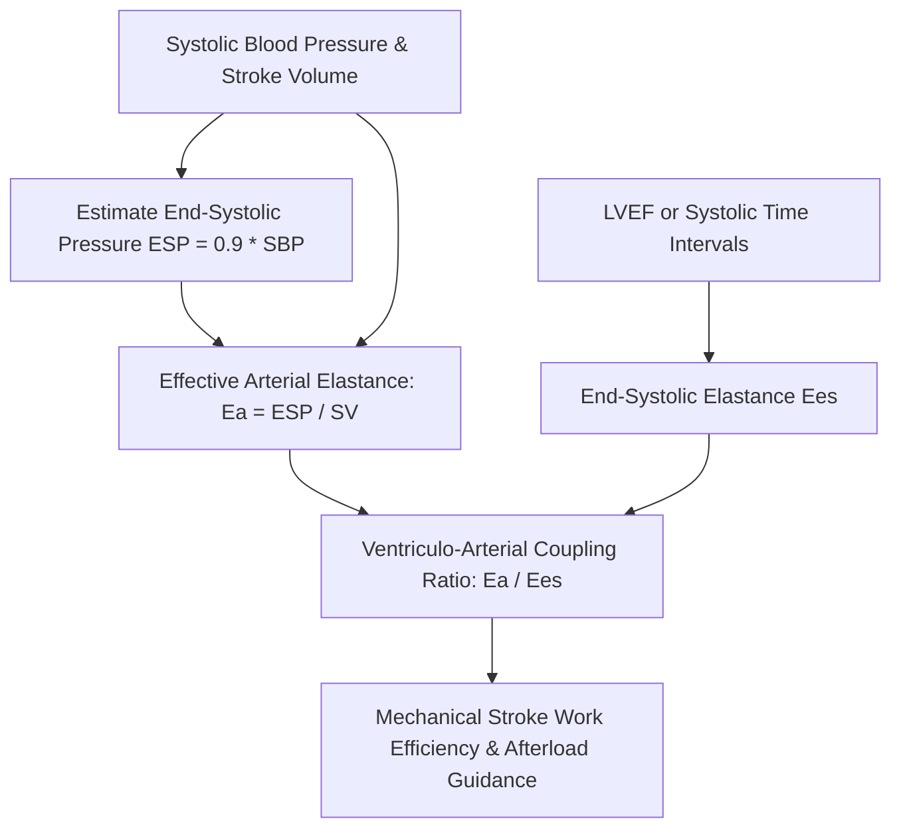

# Cardiac Ventricular Effective Arterial Elastance (Ea) Skill

[](LICENSE)
[](https://www.python.org/)
[](https://openclaw.org/)
[](https://alphapark.ai/)
[](https://modelcontextprotocol.io/)

Ventriculo-Arterial Coupling ($E_a / E_{es}$) and Effective Arterial Elastance ($E_a$) Analyzer based on pressure-volume loop physics.



## Features
- **Zero PIP Dependencies**: Implemented strictly with Python Standard Library (`math`, `json`, `sys`, `typing`).
- **Pressure-Volume Framework**: Single-beat validated elastance and coupling models.
- **Cardiovascular Energetics**: Direct computation of stroke work mechanical efficiency.
- **Dual Architecture**: Native Python import and Model Context Protocol (MCP) JSON-RPC 2.0 stdio server.

## Quickstart
```bash
python example_usage.py
```

## License
Apache-2.0
